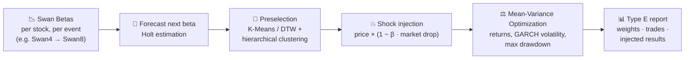

# 🦢 Black Swan Research

**A "vaccine" for market crashes: forecast how each stock reacts to the next Black Swan event, then build the portfolio that survives it.**

[Introduction (PDF)](Black-Swan%20Research%20Introduction.pdf) · [Training](training/) · [Projects](Projects/) · [Data](data/)

---

## 🧭 The idea

The research catalogs **14 Black Swan market crashes over the last 50 years** ("Swan1", "Swan2", …). For every stock it measures a **Swan Beta**: how hard the stock fell relative to the market in each of those events. Swan Betas are roughly Gaussian, which makes them usable for clustering, forecasting, and optimization.

The model has three jobs:

1. **Anticipate** potential downturns.
2. **Position** the portfolio to minimize losses in a Black Swan market.
3. **Optimize** returns during such times.

## ⚙️ The pipeline

| Step | What happens |
|---|---|
| **Swan Beta** | Sensitivity of each stock to past Black Swan drops. `data/SwanBeta/` holds S&P 100 and S&P 500 tables |
| **Forecast** | Holt's method extrapolates each stock's next Swan Beta from its history (`Projects/Holt Estimation`) |
| **Preselect** | Cluster stocks by Swan Beta (K-Means, or DTW distance with hierarchical clustering) and keep the safest representatives. **MVO DB** is the refined preselection |
| **Inject** | Apply the predicted market drop to each stock in proportion to its beta, to simulate the crash in the price data |
| **Optimize** | Mean-variance optimization with PyPortfolioOpt, using multi-horizon returns, GARCH volatility and maximum drawdown; compare Sharpe ratios against the previous weights |
| **Report** | Export `weights.csv`, `injected_results.csv` and `tradeinfo.csv`, and present them as a Type E graph in Excel |

## 🗂️ Repository map

| Path | Contents |
|---|---|
| 🎓 [`training/`](training/) | The onboarding path: **① MVO** → **② MVO DB** → **③ Gap Testing** (monthly rebalance). Each part has its own README, documentation and runnable notebook |
| 🧪 [`Projects/MVO DB`](Projects/MVO%20DB) | MVO DB research for Swan8–Swan11 on S&P 100 and S&P 500, with equal and unequal betas |
| 🧪 [`Projects/MVO DB+Holt`](Projects/MVO%20DB+Holt) | MVO DB with Holt-forecast betas; cluster evaluation for Swan11 |
| 🧪 [`Projects/Holt Estimation`](Projects/Holt%20Estimation) | Simple Holt estimate model and sample forecasts |
| 🧪 [`Projects/Gradient Matrix Test`](Projects/Gradient%20Matrix%20Test) | Gradient-matrix tests: how the results move with the number of clusters (K = 5–8) for Swan9 on the S&P 100 (OEX), and for Swan10d |
| 🤖 [`Projects/Automated Testing Scripts`](Projects/Automated%20Testing%20Scripts) | Automated S&P 100 / S&P 500 runs and gradient tests using actual betas |
| 〰️ [`dtw_result/`](dtw_result) | DTW-clustered MVO for Swan4–8, with injected results and the preselected stocks |
| 💾 [`data/`](data) | Swan Betas, Holt estimates, MVO components (market drops, adjusted prices, weights) and `optdata` |

## 🚀 Getting started

1. Read the [introduction](Black-Swan%20Research%20Introduction.pdf), then follow [`training/MVO`](training/MVO) → [`training/MVO DB`](training/MVO%20DB) → [`training/Gap Testing`](training/Gap%20Testing).
2. For training runs, use `All_SwanBeta100_MVO2` and `optdata_MVO2` from [`data/`](data).
3. The notebooks are written for Google Colab. Uploading the whole `data/` folder at once saves picking files for every run.

> 📝 MVO DB on the S&P 500 is still open research, and Swan9 cannot run on the S&P 500 yet because the matching `optdata` is missing.

## 📬 Contact

For questions about the repository, or merge requests to the main branch:

- Dennis Hu: huchenghongyochino@gmail.com
- Shuda Yang: yangshuda215@gmail.com

Shepherd Venture · Black Swan Research

